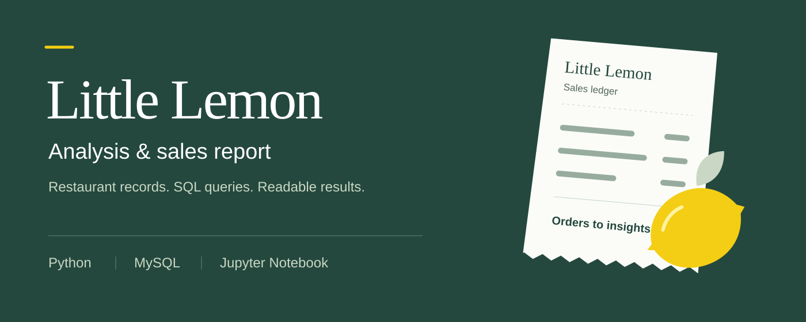

# Little Lemon — Analysis and sales report

Turn restaurant orders, bookings, and menu records into a reproducible MySQL sales report.

The notebook uses MySQL Connector/Python, a two-connection pool, stored procedures, and SQL reports to follow each result back to its source records. **All customer, employee, booking, and sales records are fictional demonstration data.** They are not presented as the official course dataset or real restaurant activity.

[Read the notebook](Little_Lemon_Analysis_and_Sales_Report.ipynb) · [Read the sales report](REPORT.md) · [Review the rubric evidence](COURSERA_RUBRIC_CHECKLIST.md)

##  Features

- A named MySQL connection pool, `pool_a`, with exactly two connections and explicit cleanup after each operation.
- Seven related tables covering customers, employees, bookings, menus, orders, order lines, and delivery status.
- Eight stored procedures for booking management, quantities, sales, customer history, popular items, and employee assignments.
- Sales totals, order values, menu/category rankings, customer spending, booking activity, and dated revenue trends.
- A runnable notebook, SQL scripts, automated tests, and a submission checklist grounded in executed results.

This is a separate companion to the [Little Lemon Django capstone](https://github.com/yaqyn/little-lemon-django-capstone). It reuses five sample menu names and prices from that project's seed code. It does not use Django's ORM, import private customer records, or change the original website, models, migrations, endpoints, or repository.

##  Installation

Requires Python 3.14 and MySQL 8.0.29 or newer; the supplied standalone service uses MySQL 8.4. Python dependencies are listed in `requirements.txt`, including MySQL Connector/Python, Jupyter, notebook execution tools, and Matplotlib for the report chart.

From the parent of the extracted project folder:

```bash
cd "Little Lemon analysis and sales report"
python3.14 -m venv .venv
source .venv/bin/activate
python -m pip install -r requirements.txt
cp .env.example .env
```

For the complete tested dependency set, install `requirements.lock.txt` instead.

Edit `.env` with your own local credentials. Keep `MYSQL_DATABASE=little_lemon_sales`; the Python configuration deliberately rejects a different schema name.

| Variable | Purpose |
| --- | --- |
| `MYSQL_HOST` | MySQL hostname; `127.0.0.1` for the documented local setup |
| `MYSQL_PORT` | `3306` for an existing server, or `3307` for this project's standalone Compose service |
| `MYSQL_USER` | Dedicated sales application account |
| `MYSQL_PASSWORD` | That account's private password |
| `MYSQL_DATABASE` | Must be `little_lemon_sales` |
| `MYSQL_ROOT_PASSWORD` | Only used to initialize the optional standalone Docker service |

### Reuse the existing MySQL server

The Django project's MySQL service can host the sales schema without changing its Compose file, `.env`, tables, or application account. Keep it running and use the same host/port with a **new restricted account**.

In your MySQL administrator session, create the sales account and grant privileges only for the new schema. Substitute a private password locally:

```sql
CREATE USER 'little_lemon_sales_app'@'%' IDENTIFIED BY 'replace-with-your-local-sales-password';
GRANT ALL PRIVILEGES ON little_lemon_sales.* TO 'little_lemon_sales_app'@'%';
```

Use the appropriate host restriction for your installation instead of `%` where possible. Account provisioning is an administrator prerequisite; all assignment database operations run through the Python pool. Set the new account's credentials in this project's `.env`. The application creates `little_lemon_sales` through a pooled connection during initialization. It never requests privileges on the Django schema.

### Use an independent Docker database

Alternatively, set `MYSQL_PORT=3307` and a separate `MYSQL_ROOT_PASSWORD` in this project's `.env`, then run:

```bash
docker compose up -d --wait db
```

The service uses its own named volume and loopback port. It does not start or reconfigure the original Django application. Stop it with `docker compose down`; the volume retains the sales data. Use `docker compose down -v` only when you intend to delete this standalone sales database.

##  Quick start

With MySQL configured and reachable:

```bash
python -m src.run --report
```

This initializes the dedicated tables, inserts missing demonstration records, creates missing procedures, validates the records, and prints the sales summary. The full results are written to `REPORT.md`, `output/sales_report.json`, and `output/monthly_sales.svg`. Connection progress, commits, and returns to the pool are visible in the output; the notebook also prints stored-procedure result sets. A failed operation prints its MySQL error and does not claim success.

Open the notebook for the section-by-section implementation:

```bash
jupyter notebook Little_Lemon_Analysis_and_Sales_Report.ipynb
```

Run its cells from the top, or choose **Restart Kernel and Run All Cells**. Stop the Jupyter server with Ctrl+C. For a fresh automated execution with saved outputs:

```bash
python scripts/execute_notebook.py
```

##  Usage

[REPORT.md](REPORT.md) explains the results and their limits. Sales are recorded in USD. Order values are checked against `Quantity × UnitPrice` from the order lines; historical unit prices are preserved separately from the current menu price. Sales totals are revenue measures, not profit: this dataset does not model ingredient costs, taxes, discounts, or a complete operating ledger.

Popularity ranks quantities in the supplied records. An item with zero recorded sales is unsold in this demonstration; that does not establish customer demand in a real restaurant. Monthly changes describe the selected sample dates, not verified business performance.

### Stored procedures

| Procedure | Arguments | Result or action |
| --- | --- | --- |
| `GetMaxQuantity` | None | Highest quantity in an order line |
| `ManageBooking` | Booking ID, date, time, table number, customer ID, employee ID | Create a validated new booking without overwriting an existing ID |
| `UpdateBooking` | Booking ID, new date, new time | Update an eligible booking after validation |
| `CancelBooking` | Booking ID | Remove an eligible booking; bookings linked to orders remain protected |
| `GetSalesReport` | None | Order count, total sales, average, highest, and lowest order values |
| `GetCustomerOrders` | Customer ID | The customer's recorded order history |
| `GetPopularMenuItems` | None | Menu items ranked by quantity ordered |
| `GetEmployeeBookings` | None | Booking assignments joined to employees |

The notebook calls procedures with `cursor.callproc(...)` and reads their result sets through `cursor.stored_results()`. Stored procedures that change bookings leave the commit decision to Python. Dates, times, table numbers, foreign keys, duplicate slots, and existing order links are validated before a mutation can succeed.

### Execute the SQL scripts through the pool

The three scripts in `sql/` are the source of the schema, sample records, and stored procedures. The normal entry point and notebook execute them through pooled connections. To invoke one explicitly from an activated project environment:

```python
from src.connection_pool import create_pool
from src.database import execute_sql_script

pool = create_pool()
execute_sql_script(pool, "seed_data.sql")
```

Initialize the schema first with the normal entry point. The script runner accepts only the project's approved SQL filenames. Use the dedicated database account; do not edit the scripts to point at the Django database.

##  Architecture

`src/connection_pool.py` owns configuration and connection acquisition. `src/database.py` applies the SQL scripts and validates records. `src/procedures.py` creates and invokes stored procedures, while `src/reports.py` holds the analysis queries. The notebook explains those operations and displays their actual results.

A pooled connection is acquired for an operation, its cursor is closed in `finally`, and `connection.close()` returns it to the pool. Uncommitted changes are rolled back during error handling or cleanup. Successful data changes use an explicit `commit()`; returning a connection is not a substitute for committing.

Initialization is safe to rerun: tables and procedures use `IF NOT EXISTS`, and seed inserts check deterministic primary keys before inserting. Existing rows and routine definitions are preserved. MySQL DDL has implicit commit behavior, so schema creation is not described as an all-or-nothing transaction; the seed-data transaction is separate.

##  Verification

```bash
python -m unittest discover -v
```

Integration tests use the configured MySQL server. Without database configuration, database-dependent tests are marked skipped/NOT VERIFIED; a configured connection failure is a failure, not a pass. Unit tests still exercise cleanup and error paths without requiring a server.

The recorded run passed **44 tests** (35 real MySQL integration tests and 9 unit tests). The full notebook executed three times with all 14 code cells completing without unexpected errors. [evidence/verification.json](evidence/verification.json) records the tested versions, row counts, and original-project preservation checks.

The suite checks pooling, acquisition and return, schema/seed creation, rerun safety, commit/rollback visibility, stored procedures, booking validation, and report calculations. [COURSERA_RUBRIC_CHECKLIST.md](COURSERA_RUBRIC_CHECKLIST.md) records the assignment checks with evidence. The notebook's saved outputs and [REPORT.md](REPORT.md) provide the executed analysis; generated output should be reproduced after changing the dataset.

##  Security and limitations

Keep `.env`, passwords, virtual environments, and caches out of Git and the submission ZIP. The sales application uses a schema-scoped account and accepts only `little_lemon_sales` as its database target. Reusing a server is not permission to alter the original application's database.

The exact original course dataset was not supplied. Demonstration records make the SQL and transaction behavior reproducible; their values are not official course data or real Little Lemon sales. Custom records are preserved when setup is rerun, so adding them can legitimately change report totals from the initial demonstration baseline.

> Learning Journey Project: a Little Lemon database analysis assignment using clearly labeled demonstration data. Implementation and verification are maintained by Abdulrahman M. Yaqyn.
