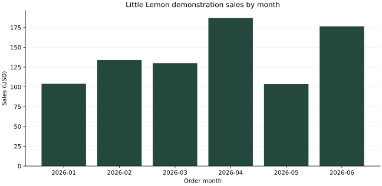

# Little Lemon Analysis and Sales Report

All records are fictional demonstration data. This is not the official course dataset or real restaurant revenue.

Amounts are USD. Revenue uses historical order-item quantities and unit prices; stored order totals are reconciled before reporting. No tax, tips, refunds, food costs, or profit figures are modeled.

## Summary

| TotalOrders | TotalSales | AverageOrderValue | HighestOrderValue | LowestOrderValue |
| --- | --- | --- | --- | --- |
| 12 | 835.00 | 69.58 | 112.50 | 31.00 |

## Category sales

| Type | QuantitySold | TotalSales |
| --- | --- | --- |
| Mains | 24 | 478.50 |
| Starters | 15 | 156.00 |
| Beverages | 37 | 133.00 |
| Desserts | 9 | 67.50 |

## Popular items

| ItemID | ItemName | Type | QuantitySold | ItemSales |
| --- | --- | --- | --- | --- |
| 3006 | Sparkling water | Beverages | 17 | 51.00 |
| 3007 | Lemonade | Beverages | 12 | 54.00 |
| 3003 | Lemon chicken | Mains | 11 | 214.50 |
| 3005 | Lemon dessert | Desserts | 9 | 67.50 |
| 3001 | Greek salad | Starters | 8 | 100.00 |
| 3008 | Espresso | Beverages | 8 | 28.00 |
| 3002 | Bruschetta | Starters | 7 | 56.00 |
| 3009 | Grilled sea bass | Mains | 7 | 168.00 |
| 3004 | Garden pasta | Mains | 6 | 96.00 |
| 3010 | Marinated olives | Starters | 0 | 0.00 |

## Least popular items

| ItemID | ItemName | Type | QuantitySold | ItemSales |
| --- | --- | --- | --- | --- |
| 3010 | Marinated olives | Starters | 0 | 0.00 |
| 3004 | Garden pasta | Mains | 6 | 96.00 |
| 3002 | Bruschetta | Starters | 7 | 56.00 |
| 3009 | Grilled sea bass | Mains | 7 | 168.00 |
| 3001 | Greek salad | Starters | 8 | 100.00 |

## Daily sales

| SalesDate | TotalOrders | TotalSales |
| --- | --- | --- |
| 2026-01-15 | 2 | 104.00 |
| 2026-02-15 | 2 | 134.00 |
| 2026-03-15 | 2 | 130.00 |
| 2026-04-15 | 2 | 187.00 |
| 2026-05-15 | 2 | 103.50 |
| 2026-06-15 | 2 | 176.50 |

## Customer history

| CustomerID | CustomerName | OrderID | OrderDate | TableNo | TotalCost | DeliveryStatus |
| --- | --- | --- | --- | --- | --- | --- |
| 1001 | Maya Bennett | 5001 | 2026-01-15 | 1 | 73.00 | Delivered |
| 1001 | Maya Bennett | 5005 | 2026-03-15 | 1 | 60.00 | Served |
| 1001 | Maya Bennett | 5012 | 2026-06-15 | 2 | 112.50 | Served |
| 1002 | Omar Faris | 5002 | 2026-01-15 | 2 | 31.00 | Served |
| 1002 | Omar Faris | 5008 | 2026-04-15 | 2 | 112.00 | Served |
| 1003 | Sofia Chen | 5003 | 2026-02-15 | 1 | 39.50 | Served |
| 1003 | Sofia Chen | 5011 | 2026-06-15 | 1 | 64.00 | Served |
| 1004 | Daniel Ortiz | 5004 | 2026-02-15 | 2 | 94.50 | Delivered |
| 1005 | Amira Patel | 5006 | 2026-03-15 | 2 | 70.00 | Served |
| 1006 | Lucas Reed | 5007 | 2026-04-15 | 1 | 75.00 | Delivered |
| 1007 | Nora Hassan | 5009 | 2026-05-15 | 1 | 35.00 | Served |
| 1008 | Ethan Brooks | 5010 | 2026-05-15 | 2 | 68.50 | Delivered |

## Top customers

| CustomerID | CustomerName | TotalOrders | TotalSpent |
| --- | --- | --- | --- |
| 1001 | Maya Bennett | 3 | 245.50 |
| 1002 | Omar Faris | 2 | 143.00 |
| 1003 | Sofia Chen | 2 | 103.50 |
| 1004 | Daniel Ortiz | 1 | 94.50 |
| 1006 | Lucas Reed | 1 | 75.00 |

## Booking count

| TotalBookings |
| --- |
| 12 |

## Booking activity

| BookingDate | BookingCount |
| --- | --- |
| 2026-01-15 | 2 |
| 2026-02-15 | 2 |
| 2026-03-15 | 2 |
| 2026-04-15 | 2 |
| 2026-05-15 | 2 |
| 2026-06-15 | 2 |

## Highest sale

| OrderID | CustomerID | OrderDate | TotalCost |
| --- | --- | --- | --- |
| 5012 | 1001 | 2026-06-15 | 112.50 |

## Lowest sale

| OrderID | CustomerID | OrderDate | TotalCost |
| --- | --- | --- | --- |
| 5002 | 1002 | 2026-01-15 | 31.00 |

## Repeat customers

| CustomerID | CustomerName | TotalOrders | TotalSpent |
| --- | --- | --- | --- |
| 1001 | Maya Bennett | 3 | 245.50 |
| 1002 | Omar Faris | 2 | 143.00 |
| 1003 | Sofia Chen | 2 | 103.50 |

## Revenue trends

| SalesMonth | TotalOrders | TotalSales | PreviousSales | RevenueChange | ChangePercent |
| --- | --- | --- | --- | --- | --- |
| 2026-01 | 2 | 104.00 | N/A | N/A | N/A |
| 2026-02 | 2 | 134.00 | 104.00 | 30.00 | 28.85 |
| 2026-03 | 2 | 130.00 | 134.00 | -4.00 | -2.99 |
| 2026-04 | 2 | 187.00 | 130.00 | 57.00 | 43.85 |
| 2026-05 | 2 | 103.50 | 187.00 | -83.50 | -44.65 |
| 2026-06 | 2 | 176.50 | 103.50 | 73.00 | 70.53 |

## Interpretation and limits

This sample spans selected dates rather than a complete trading history. Month-to-month changes describe only these demonstration records. Zero-quantity menu items have no recorded orders in this dataset; this is not evidence of real customer preferences. Sales are gross recorded order values, not profit. CancelBooking refuses bookings linked to orders so sales history remains intact.
